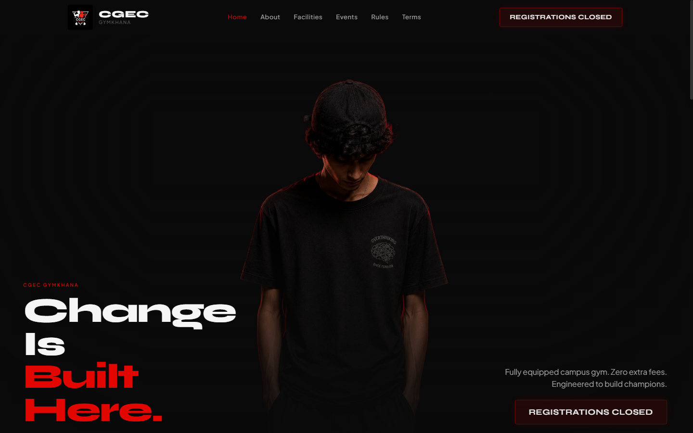
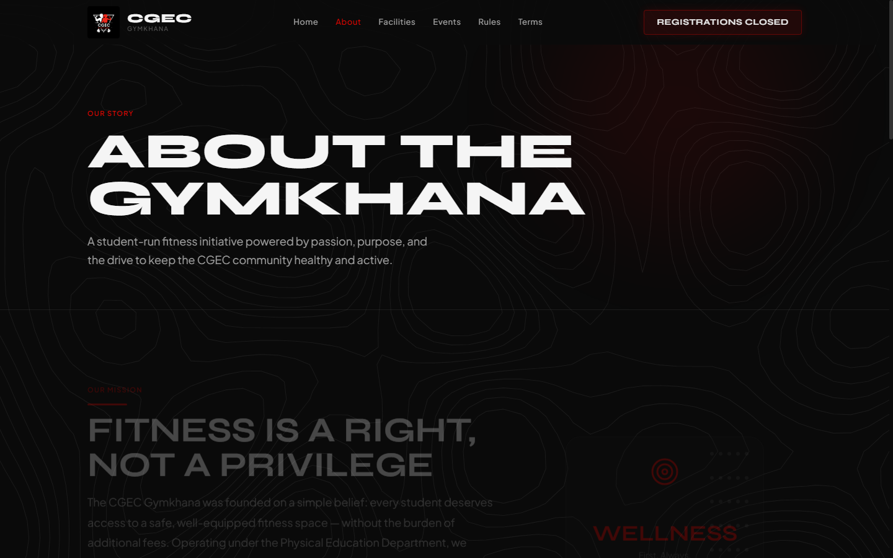
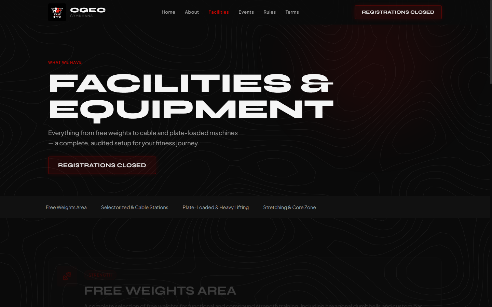
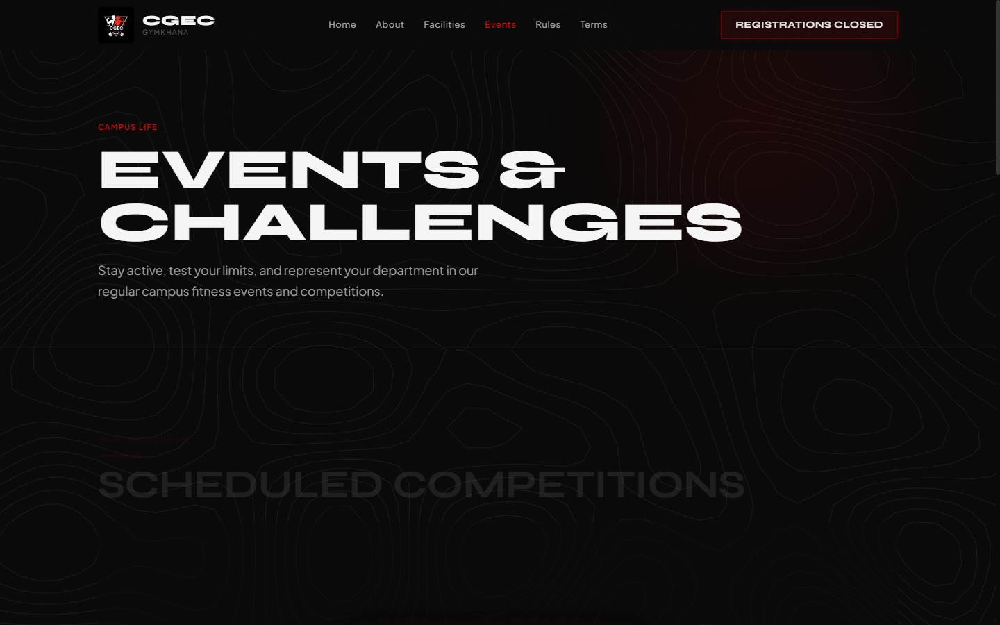
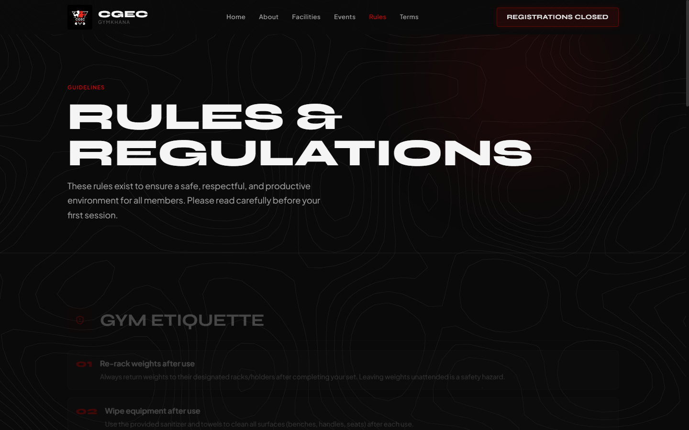
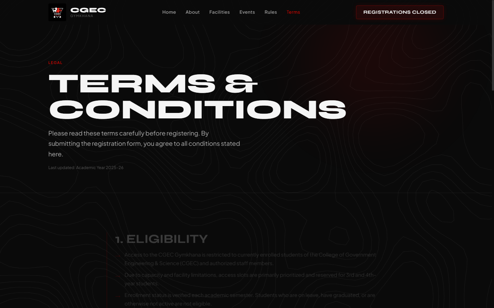

<!-- Replace docs/demo.gif with your actual screen recording -->


> Official registration & information portal for the CGEC campus gym — built for students, by students.

```bash
git clone https://github.com/Abhiyaan2003/CGEC-Gymkhana.git && cd CGEC-Gymkhana/client && npm install && npm run dev
```

🔗 **[Live site →](https://cgec-gymkhana.vercel.app)** · [Browse Facilities](https://cgec-gymkhana.vercel.app/facilities) · [View Rules](https://cgec-gymkhana.vercel.app/rules)

[](https://github.com/Abhiyaan2003/CGEC-Gymkhana/actions/workflows/ci.yml)
[](https://opensource.org/licenses/MIT)

---

## 📸 Page Previews

Explore previews of all pages across the portal:

### 1. Home
*Interactive hero section with animated body-reveal mechanics, real-time status, quick notices, and gym highlights.*


### 2. About
*History of the fitness facility, institutional mission, faculty coordinators, and student gym committee.*


### 3. Facilities
*Interactive 3D coverflow showcase of equipment zones — Free Weights, Multi-Gym Stations, Heavy Lifting, and Stretching Area.*


### 4. Events
*Campus fitness challenges, powerlifting meets, intramural sports, and competition timelines.*


### 5. Rules & Guidelines
*Operating hours, hygiene standards, slot booking protocols, and gym etiquette.*


### 6. Terms & Conditions
*Safety agreements, institutional liability policies, emergency contacts, and code of conduct.*


---

## ⚡ Features

- 🏋️‍♂️ **6-Page Student Portal**: Home, About, Facilities, Events, Rules, and Terms.
- 🎨 **Distinctive Design System**: Engineered with a signature midnight black (`#0A0A0A`) & racing red (`#E10600`) identity, pairing Barlow Condensed display headings with Inter body typography.
- 📐 **Zero-Photography Graphic Aesthetic**: Built purely around SVG topographic patterns, Lucide iconography, CSS design tokens, and curated vector assets.
- 🏎️ **Smooth Motion**: Powered by GSAP animations, ScrollTrigger transitions, and Lenis inertial smooth scrolling.
- ♿ **Accessible & Mobile-First**: Structured semantic HTML, complete keyboard navigation, skip-to-content links, and full responsiveness across phones, tablets, and desktop displays.

---

## 📁 Project Structure

```text
CGEC-Gymkhana/
├── client/
│   ├── src/
│   │   ├── components/      # Navbar, Footer, Hero, 3D Coverflow carousel
│   │   ├── pages/           # Home, About, Facilities, Events, Rules, Terms
│   │   ├── hooks/           # Scroll & layout hooks
│   │   └── lib/             # GSAP & Lenis setup
│   └── public/              # Static public assets
├── docs/
│   └── screenshots/         # Automated visual snapshots of each page
└── .github/
    ├── workflows/           # Automated CI testing
    └── ISSUE_TEMPLATE/      # GitHub issue forms
```

---

## 🚀 Getting Started

### Prerequisites
- Node.js (v18 or newer)
- npm or pnpm

### Quick Setup

1. **Clone the repository:**
   ```bash
   git clone https://github.com/Abhiyaan2003/CGEC-Gymkhana.git
   cd CGEC-Gymkhana/client
   ```

2. **Install dependencies:**
   ```bash
   npm install
   ```

3. **Start the local development server:**
   ```bash
   npm run dev
   ```
   Visit [http://localhost:5173](http://localhost:5173) in your browser.

4. **Lint and format checks:**
   ```bash
   npm run lint
   ```

5. **Build for production:**
   ```bash
   npm run build
   ```

---

## 🤝 Contributing

Contributions, bug reports, and ideas are welcome! Check out [CONTRIBUTING.md](CONTRIBUTING.md) to get started.

## 📄 License

This repository is distributed under the [MIT License](LICENSE).
